  <picture>
    <source media="(max-width: 600px) and (prefers-color-scheme: light)" srcset="./assets/generated/galaxy-header-mobile-light.svg">
    <source media="(max-width: 600px)" srcset="./assets/generated/galaxy-header-mobile.svg">
    <source media="(prefers-color-scheme: light)" srcset="./assets/generated/galaxy-header-light.svg">
    
  </picture>

 

## Professional GitHub activity

  <picture>
    <source media="(max-width: 600px) and (prefers-color-scheme: light)" srcset="./assets/generated/stats-card-mobile-light.svg">
    <source media="(max-width: 600px)" srcset="./assets/generated/stats-card-mobile.svg">
    <source media="(prefers-color-scheme: light)" srcset="./assets/generated/stats-card-light.svg">
    
  </picture>

 

  <picture>
    <source media="(max-width: 600px) and (prefers-color-scheme: light)" srcset="./assets/generated/tech-stack-mobile-light.svg">
    <source media="(max-width: 600px)" srcset="./assets/generated/tech-stack-mobile.svg">
    <source media="(prefers-color-scheme: light)" srcset="./assets/generated/tech-stack-light.svg">
    
  </picture>

 

**November 3, 2025 – November 3, 2026 (UTC).** I opened **200 pull requests**, had **176 PRs merged** during the period, and reviewed **161 distinct PRs** authored by others. My PR and review activity spanned **29 company repositories**. Of the 200 PRs opened in this period, 176 were merged, 2 remained open, and 22 were closed without merging at collection time.

The language distribution describes the current codebases of the 29 original repositories I contributed to, measured by bytes of code. It does not measure my personal code output. The stack below it is self-reported. The galaxy above maps my professional focus areas, with technologies as stars; their brightness and positions are decorative.

Source: an anonymized GitHub API export collected November 3, 2026 (UTC). This is a fixed snapshot, covering accessible employer repositories only. Review counts may omit reviews where GitHub did not update the PR timestamp. [Source data and methodology](./professional-stats.json).

## Engineering focus

I work with Go and AWS to build backend services and event-driven workflows. I value layered architecture, dependency inversion, explicit interfaces, repositories, use cases, and unit tests that keep systems understandable and testable as they evolve.

My work also spans REST APIs, JWT authentication, middleware, asynchronous workers, Clean Architecture, Domain-Driven Design, and Event Modeling.

## Stack & platforms

| Area | Technologies & practices |
| --- | --- |
| Backend | Go, TypeScript, Node.js, Python, REST APIs, asynchronous workers |
| AWS & infrastructure | Lambda, SQS, Step Functions, DynamoDB, S3, EKS, ECS, Kubernetes, Docker |
| Data & orchestration | PostgreSQL, Apache Airflow / Amazon MWAA, ingestion and preprocessing pipelines, report automation |
| Delivery & operations | Git, GitHub Actions, Argo CD, CircleCI, Jenkins, Datadog, OpenTelemetry, troubleshooting |

I also work on PostgreSQL performance through indexing, vacuum, and query tuning, along with SSO integration, user consent tracking, network segmentation, firewall and VPN management, and automated error notifications.

## Exploring AI-assisted engineering

I am developing a specialization in agent orchestration, specification-driven development, and human-in-the-loop workflows. My focus is on automating the engineering lifecycle while keeping human judgment, testability, and operational visibility central to the process.

**Everyday tools:** Linux, VS Code, GitHub, Claude Code, and Codex.

---

[Connect with me on LinkedIn](https://www.linkedin.com/in/andrezomkowski/)

Galaxy visuals generated with [Galaxy Profile](https://github.com/vinimlo/galaxy-profile).
